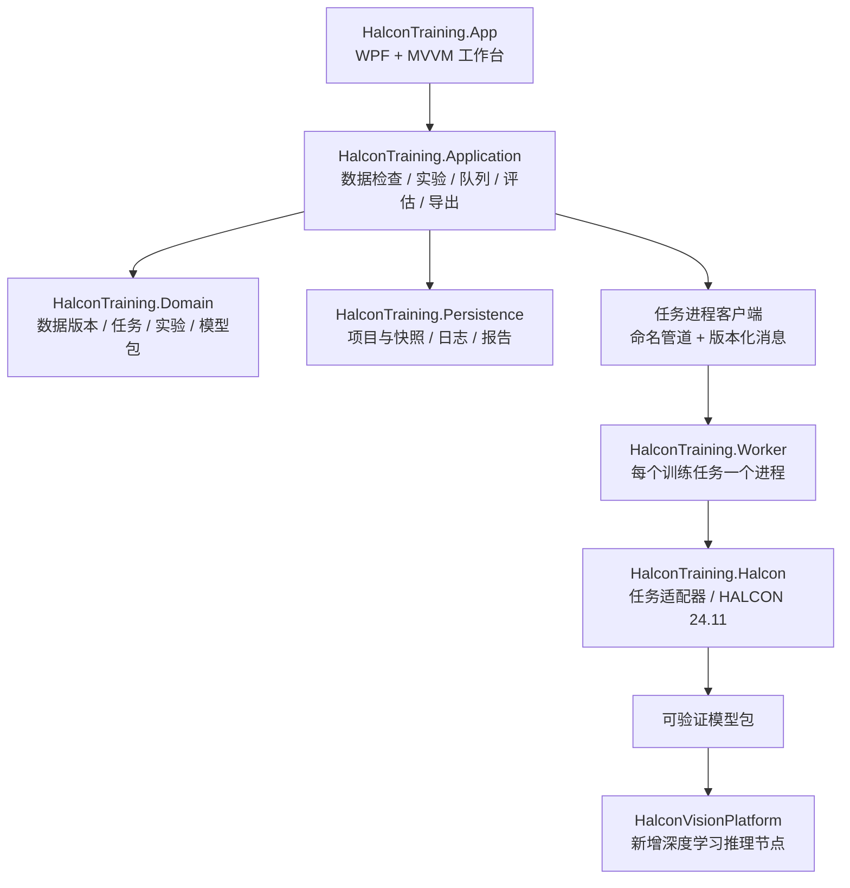

# HALCON 独立训练平台：功能、架构、可视化与开发计划

日期：2026-10-13（Asia/Shanghai）
修订：补充独立项目目录、编译依赖与 UI 分层（2026-10-13）。
状态：执行中。已完成 G0 环境探测器与 G1 六工程/WPF/Worker 骨架；尚未运行训练、标注或模型交付验收。

## 1. 已确认的产品边界

- 独立 Windows x64 桌面程序，建议名称“HALCON 训练平台”。
- 以 `D:/AiProjects/HalconVisionPlatform` 的 HALCON 24.11、.NET 8、WPF 和分层架构为基准，通过模型包对接视觉平台。
- 用户训练电脑：RTX 5060，8GB 显存。
- 首版覆盖全部常用 **2D 深度学习训练任务**：单标签/多标签分类、目标检测（水平框/旋转框）、语义分割、实例分割、普通异常检测、全局上下文异常检测，以及 Deep OCR 检测/识别组件再训练。
- “全部任务”在本方案中按上述 2D 范围解释。3D 抓取点检测、科研网络设计、基础大模型训练不计入当前工期；若需要 3D，须另列数据采集和标注方案。
- 所有任务属于同一个首版交付；开发按任务逐个完成闭环，不把检测/分割推迟到下一产品版本。
- 本次交付为计划和可交互界面概念稿，不安装依赖、不修改现有视觉平台、不启动训练。

## 2. 当前项目依据与兼容性关卡

### 2.1 可以借鉴的现有实现

视觉平台已分为 `HalconVision.App / Application / Domain / Halcon / Persistence`。当前代码具备 `INodeRegistry`、`INodeExecutor`、`NodeExecutionOutput`、`RuntimePorts`，以及图像显示和叠加层。`.hvproj` 是流程项目文件，不作为训练数据容器。

`HalconVisionPlatform/docs/evidence/HALCON_SMOKE_TEST.md` 记录本机 HALCON 24.11.1.1 的读图、二值化和连通域调用成功；它不证明深度学习授权、GPU 训练或每一种任务可用。现有 `ARCHITECTURE.md` 有部分早期描述，应以 README、代码与最新证据为准。

借鉴接口与生命周期策略，首版只抽取实际需要的显示和模型包合同，不整份复制主窗口、流程画布、相机/PLC代码。训练过程使用固定步骤工作台；生产推理使用视觉平台的节点流程。

### 2.2 HALCON 24.11 与 RTX 5060 的关键问题

MVTec 当前兼容性表列出 HALCON 24.11 使用 CUDA 12.1，GPU 计算能力范围 5.0–9.0；NVIDIA 列出 RTX 5060 的计算能力为 12.0。这套组合超出公开支持范围，**不能把本机 GPU 全任务训练作为已满足前提**。[MVTec 兼容性表](https://www.mvtec.com/products/halcon/documentation)、[NVIDIA GPU 计算能力](https://developer.nvidia.com/cuda/gpus)。

G0 必须记录：实际 HALCON 补丁版本、托管/原生 DLL 版本、驱动、GPU/可用显存、设备查询结果、深度学习许可证、基础模型来源与各任务最小训练/推理结果。官网 `/2411/` 当前文档为 24.11.3.0，不能直接证明本机 24.11.1.1 的全部能力。

处理路径：

1. 首先在现有环境做最小模型设备查询、一次真实训练与推理；单纯 `nvidia-smi`、设备枚举或传统图像算子成功不算通过。
2. 如不通过，优先在厂商明确支持的 GPU 训练电脑上运行同一个 Worker/CLI，保持 HALCON 24.11 模型交付合同；前期可用文件交换任务包和结果包，不先建设远程集群。
3. 如考虑更换 HALCON 版本，须取得该版本对 5060 的明确支持依据，并对视觉平台模型加载做验证；不能仅因 CUDA 版本更高就认定支持。
4. CPU 只对已验证允许 CPU 训练的任务开放。普通异常检测有官方 CPU 路径，其他任务逐项验证，不能承诺全任务 CPU 回退。[普通异常检测算子](https://www.mvtec.com/doc/halcon/2411/en/train_dl_model_anomaly_dataset.html)。

环境不通过时仍可管理数据、标注、配置实验和查看已有报告；启动训练按钮给出具体原因和可用设备，不伪装为可训练。

## 3. 功能与任务矩阵

HALCON 24.11 官方模型文档列出了本方案所用的主要模型类型；每类基础模型、参数、训练许可和设备能力仍需由 G0 确认。[模型与数据合同](https://www.mvtec.com/doc/halcon/2411/en/toc_deeplearning_model.html)。

| 任务 | 标注输入 | 训练配置重点 | 评估与图像展示 |
|---|---|---|---|
| 单标签分类 | 整图一个类别 | 类别平衡、尺寸、学习率 | 混淆矩阵、各类召回/F1、预测类别 |
| 多标签分类 | 整图多个标签 | 各类分布、类别阈值 | 各类 PR/F1、macro/micro 指标、标签置信度 |
| 目标检测 | 水平框或旋转框+类别 | 框型、尺寸、锚框/模型适配、增强 | mAP、PR、漏检/多检列表、预测框与真值框 |
| 语义分割 | 像素类别掩膜 | 背景/忽略类别、权重、细小缺陷尺寸 | mIoU、Dice、各类 IoU、真值/预测叠加 |
| 实例分割 | 每个实例区域+类别 | 实例分离、框与掩膜一致性 | box/mask AP、实例数量、轮廓与掩膜 |
| 普通异常检测 | 训练良品；验证/测试良品与缺陷 | domain ratio、噪声等任务专属参数 | AUROC、漏检/误杀、异常热图与阈值 |
| 全局上下文异常检测 | 良品训练及任务要求的评估标注 | 局部/全局配置、输入尺寸 | 分数分布、异常区域、局部/全局结果 |
| Deep OCR 检测 | 文本位置，按组件要求准备标注 | 文本尺寸、方向、检测组件 | 位置叠加、检测 precision/recall/F1 |
| Deep OCR 识别 | 文本裁图+真实字符串 | 字符集、长宽比、识别组件 | 整词准确率、CER、逐词错误样本 |

Deep OCR 检测与识别组件分开再训练、分别评估，再组装推理配置。[Deep OCR 官方说明](https://www.mvtec.com/doc/halcon/2411/en/toc_ocr_deepocr.html)。

### 3.1 项目与数据集

- 新建训练项目：任务类型、产品/工位、模型目录、数据根目录；项目类型创建后固定，切换任务需新建实验或项目。
- 导入图片目录、HALCON `.hdict` 数据集、统一 JSON；扩展导入 COCO、YOLO 与 Label Studio 适配器。输入格式与任务不匹配时拒绝导入并列出具体文件。
- 全部格式先转换为平台中间模型，再生成 HALCON 数据集。实例 `.hdict` 可含区域对象，不能假设 JSON 足以承载。
- 数据检查：坏图、重复图、缺失标注、越界框、未知类别、空掩膜、掩膜尺寸不符、OCR 字符集越界、类别缺失。
- 记录工件/批次/相机/采集时间。按工件或批次分组划分 train/validation/test，连拍、裁图和增强派生图跟随原图分组，防止泄漏。
- 常规默认划分可从 70/15/15 开始，比例可配置；少量数据按类别与批次核验，无法分出有效验证/测试集时阻止正式验收。
- 普通异常检测训练集只包含良品；缺陷进入验证与测试。测试集锁定，模型或阈值调整仅使用训练/验证集。
- 数据版本冻结：样本清单、标注版本、类别映射、分组划分、文件哈希、预处理配置；源文件改变会标记版本失效。

### 3.2 标注与复核

- 分类/多标签、矩形/旋转矩形、实例多边形、语义画刷/擦除、OCR 文本与位置、异常区域标记。
- 支持缩放平移、撤销重做、快捷键、自动保存、未标注/待复核筛选；类别 ID 稳定，不按显示顺序自动重编号。
- 外部标注可直接导入。内置标注优先完成编辑与复核，预标注仅作为待复核结果，不自动转为真值。
- 几何统一区分 UI `(x,y)` 与 HALCON `(row,column)`，持久化原图像素坐标；缩放、裁切、旋转保留变换与逆变换。

### 3.3 实验与训练

- 按任务提供“推荐参数/高级参数”；输入尺寸、batch、epoch、学习率等仅在任务支持时显示。
- 预训练模型从本地模型目录选择，提供版本/任务匹配检查，支持离线使用；不默认下载、不写死模型路径。
- 统一训练向导：数据检查 → 冻结快照 → 参数 → 设备验证 → 训练 → 验证 → 测试 → 导出。
- 单 GPU 默认只运行一个训练任务，队列任务绑定参数快照。预览推理不得与训练争抢同一 GPU。
- 对批次可控训练，提供真实 batch/epoch、loss、验证指标与最佳模型。普通异常检测整体算子只展示阶段、已用时间和算子最终结果，不生成虚假的逐 epoch 曲线。
- 将“停止”“强制结束”“继续训练”区分：可控批次在边界协作停止；整体算子执行中无法承诺立即停止。强制结束只终止该任务 Worker，保留上次完整产物。
- 续训按任务能力开放；必须保存优化器/训练状态、随机状态与采样状态才能称为续训。仅加载模型权重属于“从该模型创建新实验”。
- 8GB 显存下从小 batch 和经模型验证的尺寸开始，做短训练试跑并记录峰值显存；发生 OOM 后不静默减小尺寸或改变算法，提出新配置并创建新实验。容量不能仅由图像尺寸推算。

普通异常检测的 HALCON 算子一次接收整个训练数据集，内部迭代；这正是需要任务专属进度能力的原因。[训练算子说明](https://www.mvtec.com/doc/halcon/2411/en/train_dl_model_anomaly_dataset.html)。

### 3.4 评估、比较与导出

- 每次评估固定模型版本、数据版本、阈值版本及后处理配置。支持按缺陷类别、工位、批次筛选和实验 A/B 对比。
- 漏检率定义：NG 被判 OK / 真实 NG；误杀率定义：OK 被判 NG / 真实 OK。同时展示分子/分母、样本量、ERROR 数量，不把执行错误算作 NG。
- 阈值在验证集调节，保存候选版本；测试集只做最终验收，不参与反复调阈值。异常图像阈值和像素阈值分别配置，区域面积筛选单列。
- 缺少像素真值时不显示像素指标；没有缺陷样本时不计算有意义的二分类 AUROC或漏检率。
- 对推理性能报告预热后 P50/P95、设备、尺寸、batch 与是否包含读图/预处理；不拿开发机性能代替生产节拍。
- 导出 `.hdl` 模型与完整预处理/后处理合同，而不是默认 ONNX。HALCON 的 GPU/runtime 初始化设置不随模型保存，部署端重新配置。[模型保存说明](https://www.mvtec.com/doc/halcon/2411/en/write_dl_model.html)。
- 输出 HTML 报告、CSV 样本结果、JSON 指标与模型包；导出前在新进程加载模型包，跑固定验收样本并比对结果。

## 4. 独立程序架构

建议采用“WPF 工作台 + 单任务独立训练进程”，保留现有平台的分层思想。隔离训练进程用于保护界面响应、HALCON/GPU 资源回收和强制取消；无需首版微服务。



### 4.1 模块职责

| 模块 | 职责与依赖边界 |
|---|---|
| Domain | `TaskKind / DatasetVersion / Annotation / Experiment / TrainingJob / ModelPackage`；纯 C# 数据，不依赖 WPF/HALCON |
| Application | 验证、冻结、分组划分、训练调度、阈值评估、比较、导出用例；通过接口调用设备和存储 |
| Halcon | 读取/创建模型、数据预处理、各任务训练与推理、结果映射；负责句柄和 GPU 资源生命周期 |
| Persistence | `.htproj` 项目清单、JSONL 样本索引、不可变实验快照、原子保存、报告与产物校验 |
| Worker | 无界面进程，支持命名管道控制与 CLI 任务包；独立日志、心跳、退出状态与资源回收 |
| App | WPF MVVM、向导、标注、图像与图表；UI 线程只处理交互和受控显示 |

初期不引入 SQLite，避免 JSON 与数据库双写。大数据集索引瓶颈经测量后再用可重建索引优化。

### 4.2 关键接口（拟新增）

- `IDatasetImporter`：源格式 → 统一中间数据模型。
- `IDatasetValidator / IDatasetSplitter`：检查、分组划分与冻结。
- `ITrainingTaskAdapter`：`Capabilities / Validate / Prepare / Train / Evaluate / Export`；按任务有独立实现。
- `ITrainingWorkerClient`：启动、订阅事件、请求取消、受控结束、取得最终产物。
- `IDeviceCapabilityService`：HALCON 版本、许可、设备能力、最小任务验证结果。
- `IModelPackageValidator`：文件完整性、schema、哈希、版本/任务/预处理和真实加载核验。
- `ITrainingProjectStore / IExperimentStore`：保存项目、数据版本、运行事件与报告。

不要做一个包含所有任务参数的大接口；任务能力描述决定可用字段、指标、进度、取消和续训行为。

### 4.3 进程协议和状态机

消息包含 `schemaVersion / jobId / sequence / timestamp / kind / payload`。事件类型：状态、阶段、可选数值进度、指标、日志、心跳、产物、错误。HALCON 句柄不跨进程；图像预览传文件引用或受限二进制快照，图表传纯数值。

状态：`Draft → Queued → Preparing → Training → Validating → Completed`，运行态可转为 `CancelRequested → Cancelled` 或 `Failed`。测试、导出作为独立作业；训练完成不等于模型验收通过。

每任务工作目录唯一。Worker 断连先标记状态未知并尝试查询，未取得完成凭证不能宣告成功。应用重启时校验 Worker PID/启动标识和产物，孤立任务标记 Interrupted；只终止属于该作业的进程。

批次边界保存 checkpoint 至临时产物后原子发布。不可中断算子的半成品不可导出。模型/区域/图像句柄集中持有与释放，禁止在 UI ViewModel 中长期保存裸句柄。

### 4.4 项目与模型包合同

```text
用户选择的工作目录/
  product.htproj                   # 小型训练项目清单
  datasets/<version>/
    manifest.json                  # 类别/格式/哈希/分组
    samples.jsonl                  # 图像与标注索引
    splits.json                    # 不可变划分
  experiments/<experiment-id>/
    config.json                    # 任务/参数/数据版本/环境
    events.jsonl
    checkpoints/
    evaluation/metrics.json
    evaluation/samples.csv
    evaluation/report.html
  packages/<model-id>/
    manifest.json                  # schema/任务/版本/文件哈希
    model.hdl                      # 通用 DL 模型；OCR 可多组件
    preprocess.hdict               # HALCON 实际预处理参数
    preprocess.json                # 参数摘要及坐标变换合同
    classes.json                   # 稳定 ID/类别名/颜色
    postprocess.json               # 阈值/过滤/任务专属规则
    verification.json              # 固定样本验证结果
```

工作目录可配置；默认不复制整套数据，提供“制作可迁移数据包”显式复制选项。清单使用相对路径与可配置根目录映射。预处理须记录颜色/通道、尺寸、缩放/填边/裁切、灰度范围、归一化、ROI、忽略类别和逆变换。运行硬件配置与模型语义配置分离。

`.hdict` 中的对象按 HALCON 原生格式保存，避免丢失区域；原子保存时临时文件也用有效 `.hdict` 扩展名。模型包生成到临时目录，验证成功后才改为正式包，禁止覆盖历史模型。

### 4.5 源码工程与依赖方向

```text
HalconTrainingPlatform/
  src/
    HalconTraining.App/             # WPF 界面与应用组装入口
    HalconTraining.Domain/          # 纯数据与领域规则
    HalconTraining.Application/     # 用例与接口，不依赖具体实现
    HalconTraining.Halcon/          # 算法、设备与模型任务适配
    HalconTraining.Persistence/     # 项目、快照、日志与报告存储
    HalconTraining.Worker/          # 独立训练进程与 CLI 入口
  tests/                           # 领域、用例、进程、HALCON 与 UI 检查
  tools/                           # 环境与模型探测
  docs/                            # 计划、模型包合同与验证证据
```

编译依赖：`Application → Domain`；`Halcon / Persistence → Application + Domain`；`Worker → Application + Halcon + Persistence`。`App` 引用 Application，并在启动组装处连接 Persistence、HALCON 显示实现与 Worker 客户端。`App` 不引用 Worker 可执行程序集，通过进程协议连接它。

4 节架构图中的箭头表示运行时调用和产物流转；具体存储/算法实现通过 Application 定义的接口接入，不形成 `Application → Persistence/Halcon` 的反向编译依赖。共享协议 DTO 放在 Application，禁止 App 与 Worker 各自维护一份不一致的消息定义。

`HalconTraining.Halcon` 内部按 `Devices / Datasets / Preprocessing / Training / Evaluation / Models` 拆分；Training 下各任务有独立适配器，复用基础模型加载、配置验证、预处理和资源释放。HALCON 算法工程不依赖 WPF；图像显示适配器位于 App 的 Presentation 层，负责 SDK 与 WPF 控件之间的显示桥接。

## 5. 与 HALCON 视觉平台的部署对接

首版训练程序完成“离线模型包交付”；视觉平台增加推理节点作为另一个明确验收工作项。

建议节点：`halcon.dl.classification`、`halcon.dl.detection`、`halcon.dl.semantic-segmentation`、`halcon.dl.instance-segmentation`、`halcon.dl.anomaly`、`halcon.deep-ocr`。多标签/异常变体由节点参数和模型包能力约束。

输入：平台运行期图像、模型包引用、可选 ROI。JSON 输出：`modelId / taskKind / status / prediction / scores / objects / decision / durationMs / imageSpace`；运行期图像、掩膜与轮廓走 `RuntimePorts`。模型推理结果与业务 OK/NG 判断分开，阈值版本可追溯。

扩展 `DetectionOverlayScene` 以承载框、实例轮廓、热图和 OCR 文本；验证尺寸与坐标来源后才叠加。模型缓存按文件哈希/版本隔离，当前批次结束后再替换模型。启动时显式设置设备，模型包不携带开发机 GPU 索引。

模型迁移验收：新进程加载 → 固定样本逐任务推理 → 与训练平台结果比对 → 保存报告；数值容差任务分别定义，跨设备不要求不合理的逐位相同。

## 6. 可视化和交互方案

### 6.1 总体布局

桌面优先，建议最低 1280×800，常用 1920×1080；面板可折叠、分隔条可拖动，支持 125%/150% DPI。

```text
┌ 项目名 / 任务类型 / 数据版本 / 环境状态 ───── 新建实验 / 保存 ┐
│ 项目总览 │ 数据集 │ 标注复核 │ 实验配置 │ 训练监控 │ 评估 │ 模型 │
├──────────┬───────────────────────────────┬────────────────┤
│ 类别/筛选 │ 原图 / 真值 / 预测 / 叠加          │ 当前图像结果     │
│ 样本列表  │ 同步缩放和平移，像素探针           │ 阈值/面积/规则   │
│ 实验列表  │ 可切换双图/四图，显式坐标来源       │ 类别与图层开关   │
├──────────┴───────────────────────────────┴────────────────┤
│ 指标图表 / 错误样本列表 / 队列 / 可展开日志                   │
└ 当前阶段 / 设备 / 已用时间 / 数据检查 / 作业状态 ─────────────┘
```

使用浅灰工具面板、深蓝图像画布、青蓝选中态；OK 绿色、NG 红色、ERROR 琥珀色，同时始终显示文字，避免仅靠颜色判定。正文使用系统中文字体，指标使用等宽数字。样本列表虚拟化，原图只按需读取。

### 6.2 七个页面的工作内容

| 页面 | 核心操作 | 主要可视化 |
|---|---|---|
| 项目总览 | 选择项目、任务、设备；发现未通过检查 | 数据/标注覆盖、最近实验、兼容性状态 |
| 数据集 | 导入、检查、划分、冻结版本 | 类别分布、批次分布、重复/坏图清单 |
| 标注复核 | 标注编辑、待复核筛选 | 大图+类别面板+标注对象列表 |
| 实验配置 | 基础模型、任务参数、预处理预览 | 预处理前后对比、短训练容量检查 |
| 训练监控 | 启动、排队、停止、恢复能力提示 | 真实 loss/指标曲线或阶段视图、资源和日志 |
| 评估对比 | 样本筛选、阈值候选、A/B比较 | 原图/真值/预测、任务专属图表、错误样本 |
| 模型管理 | 验证、导出、加载历史包 | 模型版本/数据来源/验收指标/兼容性报告 |

图表与图像联动：点混淆矩阵单元格筛选样本，点 PR/ROC 阈值查看候选判定，点错误样本定位图像。候选阈值不会隐式覆盖已发布模型包。

### 6.3 图像显示规则

- WPF 使用 `HSmartWindowControlWPF`，HALCON 算法不创建窗口；禁止把 HDevelop 的 `open_window / disp_obj / dev_display_*` 流程嵌入训练引擎。
- 显示统一经 C# 显示适配器处理；现有平台的显示层可借鉴，底层窗口调用不扩散到算法与业务层。
- 固定版本的热图色标，标出数值范围；同一对比组禁止每张图单独 min-max 归一化后误导比较。
- 原图、真值、预测、热图与轮廓可以分别开关，透明度可调；放大后仍按原图坐标定位缺陷。
- 训练进行中将日志和指标事件节流，避免每 batch 重绘大图；资源指标读取失败显示“不可用”，不编造数值。

配套 `UI_CONCEPT.html` 是离线可交互概念稿。任务选择和阈值变化用于演示界面行为，所有数据明确为示意，不执行 HALCON 算法。

### 6.4 UI 源码分层与目录

UI 采用 WPF + MVVM。在 App 工程内区分窗口壳、业务页面、可复用控件与显示适配，页面状态由 ViewModel 管理。

```text
HalconTraining.App/
  Shell/
    MainWindow.xaml                # 顶部项目栏、导航、页面容器、状态栏
    ShellViewModel.cs              # 当前项目、导航与全局状态
  Views/
    ProjectOverviewView.xaml
    DatasetView.xaml
    AnnotationView.xaml
    ExperimentView.xaml
    TrainingMonitorView.xaml
    EvaluationView.xaml
    ModelLibraryView.xaml
  ViewModels/                      # 每页一个主 ViewModel，可拆子 ViewModel
  Controls/
    ImageWorkspace/                # 原图、图层、双图/四图、同步缩放
    AnnotationEditor/              # 框、多边形、画刷、文字及交互手势
    SampleBrowser/                 # 缩略图、筛选、虚拟化列表
    ParameterEditor/               # 任务专属参数编辑
    Charts/                        # 曲线、直方图、混淆矩阵
  Presentation/
    DisplayModels/                 # 图像引用、图层、指标等纯显示数据
    TaskPresenters/                # 任务结果 → 图像/表格/图表映射
    HalconDisplay/                 # HSmartWindowControlWPF 显示桥接
    Formatting/                    # 状态文字、单位与数值格式
  Services/
    NavigationService.cs
    DialogService.cs
    UiDispatcher.cs
  Themes/
    Tokens.xaml                    # 颜色、字号、间距、尺寸
    Styles.xaml                    # 通用控件样式
    Templates.xaml                 # 任务专属显示模板
```

| UI 层 | 职责 | 调用边界 |
|---|---|---|
| Shell | 项目切换、页面导航、全局状态和错误摘要 | 不处理具体训练或标注算法 |
| View / ViewModel | 页面布局、输入、选择状态、命令、作业事件订阅 | 调用 Application 用例；不直接写文件、调用 HALCON 训练或管理 Worker 进程 |
| Controls | 图像交互、标注手势、列表和图表绘制 | 通过属性绑定与交互事件连接页面，不访问存储和训练服务 |
| Presentation | 任务结果映射为显示模型；统一显示资源管理 | 不执行训练或改变已保存模型/阈值 |
| UI Services / Themes | 导航、对话框、线程调度与统一视觉资源 | UI 服务不承担数据集校验、训练调度或评估计算 |

窗口启动处是具体实现的组装入口。ViewModel 构造函数只接收用例接口和 UI 服务；便于在没有 HALCON、GPU 和 Worker 的情况下验证命令与状态转换。

### 6.5 UI 数据流与线程规则

```text
用户操作 → View / 控件 → ViewModel 命令 → Application 用例 → Worker / 存储
Worker 事件 → Application 作业服务 → UiDispatcher → ViewModel → 显示模型 → View
图像手势 → 控件坐标转换 → 标注编辑命令 → 纯标注模型 → 保存用例
```

- ViewModel 的命令按任务状态和设备能力启用；点击开始后立即锁定本次快照，防止重复提交。支持取消的命令传递 CancellationToken，但 UI 不把“请求已发送”显示成“已取消”。
- Worker 日志与指标按 `jobId / sequence` 路由、去重并批量更新，避免后台线程直接修改绑定集合；丢失或过期事件不能覆盖较新的最终状态。
- 视图离开时停止该页面的预览和事件订阅，训练由应用级作业服务继续管理；回到页面从作业状态重新加载。Shell 始终可显示在运行任务。
- 耗时读图、缩略图生成和报告读取走后台操作，UI 线程只更新状态与显示。异步加载携带请求标识，快速切换样本时丢弃旧结果。
- code-behind 仅处理鼠标捕获、控件加载/卸载、键盘焦点等视图行为；数据验证、训练调度、阈值评估与持久化放在 Application。

### 6.6 图像所有权与任务显示扩展

`ImageWorkspace` 管理布局、图层选择、缩放和平移；`HalconDisplay` 适配器将图像绘制到 `HSmartWindowControlWPF`。ViewModel 保存文件引用或托管图像快照、几何与图层描述，不保存 `HImage / HRegion / HDlModel`。Worker 的算法句柄不跨进程共享。

显示适配器独占其本进程显示所需的 HALCON 对象，明确区分拥有资源与临时借用资源。切换样本或卸载控件时，在显示操作结束后释放旧对象；取消或过期加载结果也要释放。页面 ViewModel 通过显示服务接口请求显示，不接触裸窗口句柄。

标注编辑统一使用原图像素坐标；控件只负责视口到原图的变换，编辑命令与撤销记录保存纯几何/掩膜引用。ROI 与预测坐标还原在用例/算法层完成，显示层只消费已明确坐标空间的结果。

通过 `TaskPresenters` 与 DataTemplate 扩展各任务：分类映射为类别置信度，检测映射为框，分割映射为掩膜/轮廓，异常映射为分数和热图，OCR 映射为文本与位置。任务参数描述驱动 ParameterEditor；每类任务保留专属编辑模板，避免主窗口和单个 ViewModel 堆积任务分支。

产品包含 6.2 所列七个业务页面；概念稿中的“程序架构”页仅用于方案讲解，不作为生产导航功能。

## 7. 首版开发里程碑与验收

以下为建议估算：1 名熟悉 C#/HALCON 的工程师全职，测试/领域人员协助，数据及许可证及时提供。共约 **13–19 周**；硬件不兼容、标注生产、基础模型获取和现场验收等待不包含在内。所有任务在首版最终验收前完成。

| 阶段 | 估算 | 交付 | 完成条件 |
|---|---|---|---|
| G0 环境与全任务探测 | 3–5 天 | 兼容性报告、任务能力矩阵、最小模型清单 | 每任务真实训练/推理；不支持项有确定运行路径 |
| G1 独立工作台与进程基础 | 1–2 周 | 六个工程、Shell/页面 MVVM、主题资源、显示桥接、项目存储、Worker、队列、事件协议 | 依赖方向符合 4.5；启动/断连/重启/取消可追溯；切页保留任务；UI 不被训练阻塞 |
| G2 数据和标注 | 3–4 周 | 以 HALCON 24.11 DLDataset/HDict 为核心的导入、中间模型、检查、版本划分、ImageWorkspace、SampleBrowser、AnnotationEditor | DLT/本地任务数据可导入与编辑；往返不丢框/掩膜/文字；缩放编辑、撤销与异步切图正确 |
| G3 分类和异常闭环 | 2–3 周 | 单/多标签、普通/全局异常训练评估导出 | 新进程重新加载模型包，指标与图像结果有效 |
| G4 检测和分割闭环 | 3–4 周 | 水平/旋转检测、语义/实例分割 | 对照真值评估，坐标还原与 mask 对齐通过 |
| G5 Deep OCR 与统一比较 | 2–3 周 | 两组件再训练、任务专属评估、TaskPresenters/显示模板、图表联动、A/B 比较 | 字符集/文本框验证、组件组装与再加载推理通过；各任务共享工作台并呈现专属结果 |
| G6 集成和发布验收 | 1–2 周 | 独立程序安装包、使用文档、模型包合同、视觉平台对接证据 | 全任务验收矩阵完成，兼容性限制明确，旧项目正常 |

首批实施顺序：先 G0，随后立起 Worker 与一条最小训练链路，再扩展数据标注与任务适配器。不要先完成全部界面后才验证真实训练。

### 7.1 必须覆盖的验证场景

1. 每个任务：小型金标准数据集完成导入、训练、验证、测试、导出与新进程重载；OCR 按组件分别覆盖。
2. 数据：中文路径、项目迁移、坏图、重复图、同工件分组、负样本、空标注、忽略像素、实例重叠、旋转角度、未知字符。
3. 坐标：同图裁切/填边/旋转后还原到原图，标签与预测同空间，图像缩放不改变持久化坐标。
4. 生命周期：协作取消、整体算子强制结束、应用重启、GPU OOM、Worker 崩溃、磁盘不足，不发布残缺模型。
5. 模型合同：缺文件、哈希不符、版本不符、类别错位、预处理缺失必须拒绝加载并显示原因。
6. 评估：阈值只使用验证集；计数分母准确；无缺陷或无像素真值时指标不可用；ERROR 与 NG 分开。
7. 图像与 UI：DPI、双图同步、图层颜色/文字、热图固定色标、列表虚拟化、训练时持续交互。
8. 视觉平台：新增推理节点通过实际模型包测试，传统读图/二值化/Blob/直线流程无回归。
9. UI 分层：验证 ViewModel 命令与状态转换无需真实 HALCON；Application/Domain 无 WPF 依赖，算法层无显示窗口调用，文件写入统一经过存储用例。
10. UI 并发与资源：训练中切页并返回、快速切图、重复点击开始、延迟/乱序事件、关闭预览窗后继续训练；旧样本不覆盖新样本，无重复作业与残留订阅，显示对象完整释放。

准确率、漏检上限、误杀上限及产线 P95 时延由实际产品验收样本与节拍制定，不在缺数据时给出虚构目标。

## 8. 待决策项与下一步

- 已确认：独立程序、HALCON 24.11 基准、RTX 5060 8GB、首版全任务；六个工程分层，UI 采用 WPF + MVVM 与 Shell/页面/控件/显示适配分层。
- 需 G0 证据：目标补丁版本的任务/许可/设备能力；本机 GPU 不通过时使用哪台受支持训练机。
- 需业务样本：各类缺陷、工件/批次划分、验收指标、OCR 是否同时需要检测与识别再训练。
- 下一实施动作：完成 G1 页面分离与 Worker 状态管理；真实任务 G0 需要训练许可和任务金标准数据，GPU 训练需先解决当前组合超出公开支持范围的问题。

代码与测试未来只属于 `HalconTrainingPlatform`；视觉平台推理适配单独变更，不修改 speaker-inspection 的训练工具。HALCON 运行库、授权文件、真实数据、模型、日志和结果不提交 Git。

## 9. 执行进度（2026-10-13）

### G0 已实现的环境采集

- `HalconTraining.Worker --environment-probe` 输出结构化 JSON，支持调用方提供报告输出路径。
- 检查项覆盖 Windows/x64、HALCON 环境变量/安装版本/native DLL、HALCON 原生运行时、NVIDIA 驱动与显存、HALCON DL GPU 设备枚举、公开 GPU 支持范围、训练许可状态及十类任务的真实验收状态。
- 本机实际结果：HALCON `24.11.1.1` / .NET `8.0.30`；NVIDIA GeForce RTX 5060 Laptop GPU，驱动 `616.92`，显存 `8,151 MiB`；HALCON 可枚举一个 DL GPU 设备。
- 本机显卡计算能力 `12.0`，HALCON 24.11 公开 GPU 范围 `5.0–9.0`，所以报告为 `Unsupported`。设备枚举通过不能覆盖这一兼容性限制，也没有执行 DL 推理或训练。
- 深度学习训练许可保持 `Unknown`，分类、检测、分割、异常检测及两类 Deep OCR 任务全部标记 `NotRun`。

### G1 已实现的进程和界面骨架

- 创建六工程解决方案与项目级约束：Domain、Application、Halcon、Persistence、Worker、WPF App。
- 实现七页导航 Shell、MVVM ViewModel、状态主题资源、兼容性提示与环境检查表格。
- WPF 通过当前用户私有命名管道启动短任务 Worker；消息包含 schema 版本、作业编号、序号、UTC 时间、类型和 JSON payload。Worker 输出配置化结构化报告，异常时返回结构化失败消息。
- 已完成 Release 构建（`-p:NuGetAudit=false`，使用本机缓存包）和独立 Worker 命名管道端到端 smoke：报告返回成功，jobId 与协议版本一致。
- 原子 JSON 报告存储已实现。模型训练 Worker、项目/实验持久化、数据导入与标注、任务训练适配器、HALCON UI 图像显示及视觉平台推理节点尚未实现。
- 七个业务页已拆分为独立 ViewModel；项目总览使用环境专属视图，其余页面使用工作台视图模板和各自功能卡片，导航显示选中态。
- Domain 定义作业快照和 Created / Queued / Preparing / Training / Validating / CancelRequested / Completed / Cancelled / Failed / Interrupted 状态；Application 状态机校验转换、进度范围及终态不可变。Worker 事件到作业状态服务的运行时接线、取消信号、进度持久化仍待实现。
- 最新 Release 构建成功，0 警告、0 错误。因构建机无法连接 NuGet.org 安全审计源，使用 `-p:NuGetAudit=false` 和本机缓存包；这不是安全审计结果。

### 当前关卡与后续顺序

1. HALCON/GPU 的设备枚举可用，但公开支持范围不匹配；在取得 MVTec 对当前 GPU/HALCON 组合的支持证据前，暂停该机器上的 GPU 训练适配。准备支持范围内的训练设备，或另行验证受支持的 HALCON 版本。
2. 取得训练许可状态和每种任务的金标准数据、基础 `.hdl` 模型与验收标准后，完成 G0 真实任务探测。
3. 持续完成 G1：状态机规则已实现；后续接入 Worker 事件持久化、进度/取消控制、页面视觉模板及发布包验收。
4. 按 G2–G6 完成数据/标注、任务适配器、评估、模型包、推理集成和全任务发布验收。


## 2026-10-15 分类训练实施更新

以上早期进度作为历史保留。当前正式入口是原生 WPF，四页导航和真实语义分割闭环已实现；本次新增单标签图像分类训练、每轮验证准确率、独立重载评估、混淆矩阵、原图批量测试及类别置信度显示。模型按任务分别归档。桌面分类数据集已实测，不以通用环境探测中的公开GPU支持范围提示代替实际任务执行结果。

分类数据生命周期与验证范围见 CLASSIFICATION.md；短轮次功能验证不等于业务精度验收。目标检测等其余任务仍需各自实现和验证。
